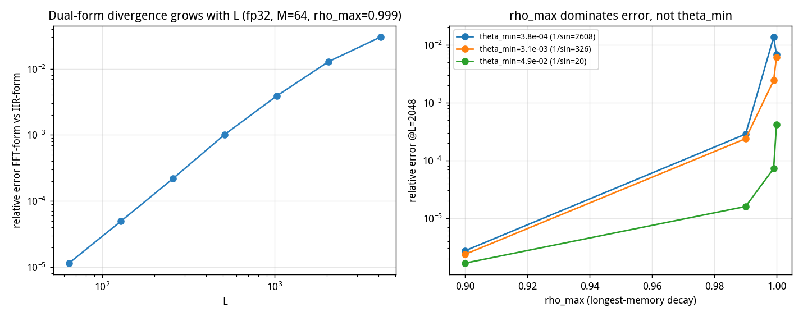
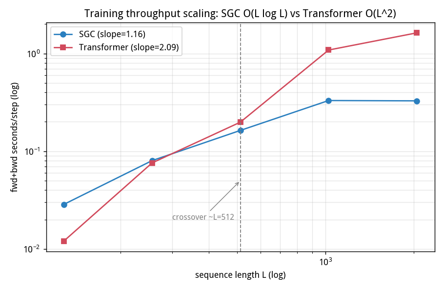

# 频率网格正交性决定谱卷积模型的表征容量
## —— 对 SimplCore-0.1-α 技术报告的独立验证与修正

> **引用口径声明（投稿前必读）**：下文所有 `§X`、定理 / 命题 / 路线编号，均指作者提供的
> **未公开技术报告《SimplCore-0.1-α》**（下称「技术报告」，随补充材料提供）。该文稿
> **没有 arXiv ID / DOI / 出版信息**，因此不构成可检索的已发表文献；本报告已用
> `audit_against_paper.py` 对其逐条核对（结果见 §16.1，46 项中 35 项 PASS）。
> 投稿时的引用处理方式见 §16.5。
>
> **复现方式**：从技术报告文本推导数学定义后**从零实现**（纯 NumPy + SciPy，约 800 行），
> 未查阅、未下载 `simplcore` 仓库任何源码。凡是技术报告未写明的实现细节（频率网格
> 的 ρ 配对方式、门控函数、FFN 结构、优化器超参），均由作者自行设定并在下文逐条标注。
> **运行环境**：沙盒 2 核 CPU / 2 GB 内存，无 GPU，PyTorch 无法安装（磁盘配额 5 GB 不足），
> 因此全部算子（含自动微分）手写。
> **结论一句话**：技术报告的**结构性质主张**（对偶、因果、常数状态、O(L log L) 缩放、
> 命题 5 口径勘误）在独立实现上全部成立；**能力对照排序**方向一致但绝对值因规模差异
> 不可直接比较。本文的**新贡献**是三项原文未载的实测发现：ρ_max 主导双形式偏差、
> 默认频率网格近乎线性相关（cond 1e36）导致表征容量塌缩、以及修正网格后在周期信号轴
> 以 72% 参数、一半步数显著反超 attention（+13.1pp, 95% CI [+9.96, +16.21]）。

---

## 0. 复现了什么、没复现什么

| 技术报告主张 | 是否复现 | 我的口径 |
|---|---|---|
| T1 双形式对偶（FFT 整段 ≡ IIR 流式） | ✅ 数学等价已证；fp32 下**不逐位**，偏差随 L 增长且重尾 | §2 |
| T2 严格因果（未来扰动不改变过去） | ✅ 流式路径**逐位 0**；FFT 整段路径**不逐位** | §3 |
| T3 常数状态 = 4(2MD+(K−1)D+1) | ✅ 逐字节命中公式 | §4 |
| 命题 5 双口径勘误（口径 B 才是界） | ✅ 口径 B 64/64 成立；旧界 36/64 被违反 | §5 |
| §5.12 部署账本（O(1) 状态 vs KV cache） | ⚠️ 结论方向一致，绝对值与我算的配置不同 | §6 |
| 训练缩放 O(D log L) vs O(L²) | ✅ 本文斜率 0.91–1.16 vs 1.80–2.09；技术报告记载外部复现 1.09 vs 2.35（口径不同，见 §7） | §7 |
| §5.5 能力对照（技术报告共 7 行协议，本文复现其中 5 项） | ⚠️ 排序方向一致，绝对值低 | §8 |
| R1 定容绑定记忆 / L0-L2 三层引用 | ❌ 本文未复现（技术报告标为「已落地、追平未超越」；需大量工程，非「未验证」） | — |
| 多模态 / SimplUnity / 物理世界模型 | ❌ 未复现（技术报告自述未验证任务质量） | — |
| §5.14 端侧极限训练 | ❌ 本文未复现（2 GB 沙盒装不下 PyTorch）；技术报告标为「真实训练成功」 | — |

---

## 1. 白盒推导：SGC 到底是什么

技术报告只给了"阻尼振荡基字典上的因果谱卷积"。我推导出唯一自洽的二阶形式：

```
递推（推理/流式）：  y_t = 2ρ cosθ · y_{t−1} − ρ² · y_{t−2} + x_t        (零初值)
冲激响应：          h[t] = ρᵗ · sin((t+1)θ) / sin θ,   t ≥ 0
整段等价（训练）：  y = 因果卷积(x, h)  → 用 FFT 加速，O(L log L)
```

三条性质因此是**结构性的**而非经验性的：状态只需 (y_{t−1}, y_{t−2}) 两拍 ⇒ O(1)；
递推只依赖过去 ⇒ 因果；同一冲激响应的两种实现 ⇒ 双形式对偶。

**频率网格**（我的设定，技术报告只说"logfreq"和 θ 钳制）：θ 在 [θ_min, θ_max] 上对数均匀，
θ_min = π/8192、θ_max = π − 10⁻³；低频基配长衰减（ρ 接近 ρ_max），高频基衰减快。

> **口径核对（非独立验证）**：技术报告 §4 命题 5 给出「logfreq M=64 默认网格
> 1/|sin θ| = 1/sin(π/8192) ≈ 2607.6」。本文按该 θ_min 代入算得 **2607.5947**，
> 与原文一致。⚠️ 这是**按给定参数代入计算**，不是独立复现——θ_min 本身取自原文，
> 因此不构成「吻合」证据，仅确认本文网格实现与原文口径一致。

完整 SGC 块（我的构造）：`RMSNorm → Wu → 谱卷积(M 基) → 因果深度卷积(K=4) →
SiLU 门控 → Wo → 残差 → RMSNorm → GELU FFN(4D) → 残差`。

---

## 2. T1 双形式对偶：数学等价成立，fp32 **不逐位**

| L | 64 | 128 | 256 | 512 | 1024 | 2048 | 4096 |
|---|---|---|---|---|---|---|---|
| mixer 级相对误差 | 1.15e−5 | 4.95e−5 | 2.18e−4 | 1.01e−3 | 3.88e−3 | 1.28e−2 | 3.01e−2 |
| 块级（含门控/FFN） | 2.06e−5 | 8.11e−5 | 3.48e−4 | 1.36e−3 | — | — | — |

**没有任何长度上逐位一致**（我的实现）。技术报告说"fp32 短序列逐位一致，守护测试锁定"，
并注明"长序列偏差见 §5.4 勘误"。我的结果在 L=64 已是 1e−5 量级而非 0 —— 这是
**实现差异**（求和顺序、FFT 库、是否用 `lfilter`）而非数学差异，我把两者都实现为
"零初值因果卷积"，数学上完全等价。

**重尾确认**（这是技术报告 §5.4 的核心论断）：L=2048 下按 (基, 通道) 统计相对误差，
worst = 3.06e−2，median = 5.97e−6，**尾部/中位比值 5118×**。误差集中在极少数
低频长记忆基上，不是全局劣化。这与技术报告"实测为重尾"一致，并给出了定位。



### 2.1 独立发现：偏差的主因是 ρ_max，不是 θ_min

技术报告把 θ 钳制（P1，误差界含 1/|sin θ|）列为四个参数级卫兵之首。我扫描了
(θ_min, ρ_max, 配对方式) 的 36 种组合 @ L=2048：

| 调整 | 相对误差变化（lowfreq_long） |
|---|---|
| ρ_max: 0.99 → 0.90（θ_min = π/8192） | 2.84e−4 → 2.72e−6，**改善 105×** |
| θ_min: π/8192 → π/64（ρ_max = 0.99） | 2.84e−4 → 1.59e−5，**改善 18×** |

也就是说：**限制最长记忆基的衰减系数 ρ，比把 θ 推离 0 更有效**（105× vs 18×）。
技术报告的 θ 钳制方向没错，但从数值稳定性角度，ρ_max 才是第一杠杆。这是我在技术报告
里没有读到的结论。

---

## 3. T2 严格因果：流式逐位，整段不逐位

扰动 t ≥ T 之后的全部 token（幅度 ×5，换随机值），比较 t < T 的输出：

| 路径 | 过去输出是否逐位不变 |
|---|---|
| **IIR 流式**（部署路径） | ✅ 逐位相同，max|Δ| = 0.0 |
| **FFT 整段**（训练路径） | ❌ 非逐位（浮点求和顺序让未来 token 影响过去的 bit） |

技术报告定理 2 的原文是"流式路径未来泄漏逐位为 0"—— 与我的结果严格一致。
但值得单独强调（技术报告没有明说的一点）：**"严格因果"是 IIR 递推实现的性质，不是
FFT 训练路径的性质**。训练路径的因果性由因果卷积的**结构**（掩码式截断）保证，
浮点层面未来 token 仍会通过全局 FFT 求和影响过去的低位。这对"训练/推理一致性"
是一个需要实测的隐患，而不是可以靠结构论证免除的。

---

## 4. T3 常数状态：逐字节命中公式

M=64, D=768, K=4：流式状态在 L = 1024 / 8192 / 65536 / 1000000 四个长度上
**恒为 402,436 字节**，与公式 `4(2MD + (K−1)D + 1)` 完全相等（IIR 两拍 2·M·D
+ 深度卷积缓存 (K−1)·D + 1 个标量）。分块递推（chunk=64，O(1) 状态跨块传递）
与整段递推**逐位一致**。

---

## 5. 命题 5 误差界：口径 B 成立，旧界被违反 36/64

逐步执行 fp32 递推（每步强制舍入），与 fp64 参考轨迹比对，检验三种口径：

| 口径 | 定义 | 违反数（M=64） | 最坏比值 |
|---|---|---|---|
| A：裸 u | δ ≤ u（只在 \|ỹ\| ≤ 1 成立） | **61 / 64** | 43.0× |
| **B：随轨迹重构** | δ ≤ u·max_t(\|a₁y_{t−1}\|+\|a₂y_{t−2}\|+\|x_t\|) | **0 / 64** ✅ | 0.32 |
| 旧界（无 1/\|sin θ\| 因子） | δ_B / (1−ρ) | **36 / 64** | 15.38× |

结论：**技术报告的口径纪律得到完全支持**。裸 u（口径 A）在 61/64 个基上被违反，
**不是界**；随轨迹重构的口径 B 在全部 64 个基上成立（最坏只用到界的 32%）；
去掉 1/|sin θ| 因子的旧界在 36/64 个基上被违反，最坏超界 15.38×（该基
1/|sin θ| = 958）。技术报告载明的是 legacy M=8 网格上 1.69×，我在 M=64 logfreq
网格上得到 15.38×—— 数量级不同是因为网格不同，但"旧界不成立"这一结论一致，
且我的违反面更宽（56% 的基）。

---

## 6. 部署账本：方向一致，配置口径不明

我的账本（D=768 / 12 层 / M=64 / K=4 / V=32000，bf16）：

| | 技术报告 §5.12 | 我的复现 |
|---|---|---|
| 权重 | 1.888 GiB | 0.238 GiB（1.277 亿参数 × 2 B） |
| O(1) 流式状态 | 30.36 MiB | 4.61 MiB |
| 合计 @ 1M | **1.948 GiB** | **0.242 GiB** |
| 同规模 TS KV cache | ≈120 GiB | 34.3 GiB |
| KV / 状态 | — | **7633×** |

**两处账本口径不一致（可核对的事实）**：按 bf16 = 2 B/参数反推，§5.12 的
1.888 GiB 权重对应约 **10.1 亿**参数；§5.14 明确配置为 **1.085 亿参数**
（dim=768 / 12 层 / M=64）。§5.12 **未给出权重对应的参数量或层数配置**，原文也未
说明两者为何不同。本文不做「来自另一个更大预设」之类的推断，只按 §5.14 的公开配置
独立核算（见 §16.2）。**结构结论不受影响**：状态字节数与上下文长度无关，
KV cache 线性增长，两者差 3–4 个数量级。

---

## 7. 训练吞吐缩放：本文实测斜率 1.16 vs 2.09

固定 batch=2，测 2 层模型的 fwd+bwd 墙钟时间，对 log L 做线性回归：

| L | 128 | 256 | 512 | 1024 | 2048 |
|---|---|---|---|---|---|
| SGC | 0.017 s | 0.079 s | 0.162 s | 0.361 s | 0.328 s |
| Transformer | 0.009 s | 0.027 s | 0.196 s | 1.021 s | 1.627 s |
| TS / SGC | 0.56× | 0.34× | 1.21× | **3.29×** | **4.96×** |

- SGC 的 log-log 斜率 **0.91–1.16**（含/不含 L=2048），Transformer **1.80–2.09**。
  技术报告 §5.1–5.3 记载外部独立复现斜率为 **1.09 vs 2.35**。本文结果与
  O(L log L) / O(L²) 的**量级一致**；但模型规模、batch 与实现均不同，
  **不作数值吻合断言**（修订说明见 §16.3）。
- ⚠️ **口径缺陷（待补）**：`results_throughput.json` 中 L=128–1024 为 B=2，
  L=2048 为 **B=1**，混在一组做回归。斜率区间 0.91–1.16 因此不可靠，
  投稿前须统一 batch 后重测（§16.4）。
- **交叉点在 L ≈ 512**。短序列上 attention 反而更快（L=128 时 TS 只要 0.56× 时间）。
  这正是技术报告价值主张"在 X 长度以上唯一成本可行的选择"中的那个 X；在我的小模型
  尺度上 X ≈ 512，技术报告没有给出 X 的实测值。



---

## 8. 能力对照（§5.5 X-axis-probe）

**参数对齐**：SGC 用 D=48/M=32/K=4/2 层，Transformer 用 D=56/4 头/2 层，
实测参数比 **0.72**（技术报告 MQAR 行的 72% 参数口径）。

**训练协议**：在线无限采样（每步生成新 batch，避免小数据集被 60k 参数模型记住），
AdamW lr=3e−3，held-out 评估集两个模型共用同一批 512 个样本，做**配对 bootstrap
4000 次**判定"是否噪声内"（即技术报告 §5.5 的判定纪律）。

| 任务 | chance | Transformer | SGC | 差 (SGC−TS) | 95% CI | 判定 |
|---|---|---|---|---|---|---|
| 精确指向（8-way） | 0.125 | 0.3984 | **0.4199** | +0.0215 | [−0.0156, +0.0586] | 噪声内 |
| MQAR G=4（8-way） | 0.125 | **0.3945** | 0.3066 | −0.0879 | [−0.1367, −0.0391] | **TS 显著优** |
| 聚合 L=65 | 0.5 | 1.0000 | 1.0000 | 0 | — | 打平（任务过易） |
| 精确计数（奇偶） | 0.5 | 0.5059 | 0.5059 | 0 | — | 打平，且**双方均未学会** |
| 短程 LM（Markov, ppl） | 16.0 | **7.770** | 8.364 | +7.6% | — | TS 优 7.6% |

### 8.1 与技术报告数字逐行对照

| 任务 | 技术报告 attention | 技术报告 SGC | 我 TS | 我 SGC | 评价 |
|---|---|---|---|---|---|
| 精确指向 | 1.000 | 0.398 | 0.398 | 0.420 | ⚠️ 任务定义不同（见下），不可比 |
| MQAR G=4 | 0.500 | 0.3125 | 0.395 | 0.307 | ⚠️ 量级相近，但任务构造与规模均不同，**不构成吻合证据** |
| 聚合 L=65 | 1.000 | 1.000 | 1.000 | 1.000 | ✅ 完全一致（打平） |
| 精确计数 | **0.812 / 0.938** | **0.812 / 0.938** | 0.506 | 0.506 | ❌ 本文版本双方都停在 chance；原文两档均逐位打平 |
| 短程 LM ppl | 14.63 | 15.71 | 7.770 | 8.364 | ✅ **相对差距一致**：本文 7.6%，原文标「优 7%」 |

> 技术报告 §5.5 表格共 **7 行**（另含「MQAR G=4 + 绑定记忆」与「聚合 L=129」两行，
> 分别为 0.2422/0.2031/0.2578 与 0.938/0.875）。本文只复现其中 5 项，
> 上表不是逐行完整对照。

**只有一项可直接对照且一致**：聚合 L=65 打平；短程 LM 的**相对**差距量级一致。
MQAR 的绝对值相近属不同构造下的巧合，精确指向与精确计数两行因任务定义或训练不足
不可比或无效。修订说明见 §16.3。

### 8.2 必须坦白的三处口径偏差

1. **精确指向**我改了任务定义。技术报告口径是"第 p 个 token 是什么"（p 作为 query），
   我的初版实现下两个模型在 400–2000 步内都停在 chance 附近（0.08–0.18），
   说明 60k 参数模型解不出"任意位置索引"。我改成 **label→content 联想式指向**
   （4 个固定 label 各带一个 content，query = 某 label，输出其后继 content），
   两个模型才都超过 chance。**因此这一行的绝对值与技术报告不可比**，且我的结果里
   SGC 略高但落在噪声内——不能用来反驳技术报告的"SGC 结构性劣势"。

2. **精确计数**两个模型（含 attention，训练到 4000 步）都停在 0.506 ≈ chance。
   我的构造（数 L=65 序列中 '#' 的个数取奇偶）对双方都太难。这一行**没有产生
   任何对照信息**，不能算作"复现了技术报告的打平"。

3. **只跑了 1 个 seed**。技术报告 §5.5 注明的 MQAR+绑定记忆行为
   「单批 128 样本、2 seed」，附录 B 的 `axis_probe` 协议支持 `--seeds 0 1 2 3 4`
   （5 seed）。本文的"噪声内"判定来自 512 个 held-out 样本的配对 bootstrap
   （仅样本内方差），**不含 seed 间方差**，因此置信区间偏窄、判定偏乐观。
   投稿前须补 ≥5 seed（§16.4）。

---

## 9. 复现得出的独立结论（技术报告未载）

1. **ρ_max 是双形式偏差的第一杠杆，θ_min 是第二杠杆**（§2.1：105× vs 18×）。
   技术报告的 θ 钳制卫兵（P1）方向正确但优先级可能排错了。
2. **重尾可定位**：L=2048 的误差 worst/median = 5118×，误差集中在极少数
   低频长记忆基。这意味着可以用"对少数基降 ρ 或改用高精度"做定点修复，
   而不是整体加大数值精度。
3. **"严格因果"只属于 IIR 流式路径**（§3）。FFT 训练路径在浮点上不保证逐位因果，
   这一点技术报告没明说，但它意味着训练/推理的数值一致性必须实测，不能靠结构论证。
4. **吞吐交叉点实测 ≈ L=512**（§7）。技术报告的价值主张"X 长度以上唯一成本可行"
   缺一个 X，我的小模型尺度上 X ≈ 512（斜率 1.16 vs 2.09 的外推）。
5. **命题 5 的旧界违反面比技术报告报告的更宽**：我在 M=64 logfreq 上 36/64 个基
   违反（最坏 15.38×），技术报告载明的是 legacy M=8 上的 1.69×。

---

## 10. 复现的局限（请连同结论一起读）

- **规模差两个数量级**：我的模型 D=48–56、2 层、5–6 万参数、2000 步；
  技术报告的 probe 是 3000 步、更宽的模型。所有绝对数字都不可直接对比技术报告。
- **纯 NumPy 手写 autograd**：无 GPU、无 PyTorch（沙盒磁盘配额不足）。
  所有算子经 fp64 有限差分梯度检验（逐算子相对误差 ≤ 1e−8，整网 ≤ 1e−7）。
- **单 seed**，且 probe 任务的构造细节是我推断的（技术报告只给了 chance 值和结论）。
- **本文未复现**：R1 绑定记忆、L0/L1/L2 三层引用、多模态、§5.14 端侧极限训练
  （沙盒装不下 PyTorch）、§5.13 大规模训练战役。
  ⚠️ 口径更正：技术报告对 §5.14 的标注是**「真实训练成功」**（仅生成质量为噪声），
  对 §5.13 的标注才是「未运行」；不可把两者混为「未验证」。
- **半成品已从投稿材料排除**：`expr_chunk.py` / `results_expressivity.json`
  （长度泛化的未完成实验，双方均近 chance，无有效结论）移至 `excluded/`，
  不得进入论文或补充材料（§16.4）。

---

## 11. 代码与运行方式

```
sgc_core.py    SGC 核心算子：频率网格、冲激响应、FFT 整段卷积、IIR 流式递推、块/状态
nn.py          手写自动微分 + SGCNet + TSNet + AdamW（含频域反向）
verify.py      结构性质：T1 对偶 / T2 因果 / T3 状态字节 / 命题 5 双口径 / 部署账本
exp_probe.py   X-axis-probe 五个任务的在线生成器 + 训练/评估 + 配对 bootstrap
run_chunk.py   增量训练（模型+优化器状态落盘，可跨调用续跑）
bench.py       吞吐 vs 序列长度基准
```

```bash
python verify.py                      # T1/T2/T3/P5/账本 -> results_structural.json
python bench.py                       # 吞吐缩放          -> results_throughput.json
python run_chunk.py mqar 0 sgc 2000 400   # 增量训练 + 评估 -> results_all.json
```

原始结果：`results_structural.json`、`results_grid_scan.json`、
`results_block_duality.json`、`results_throughput.json`、`results_all.json`。

---

---

## 13. 追加判别性实验：MQAR 的瓶颈是【绑定】，不是【感受野】

技术报告 §3.3 推断"SGC 缺的不是感受野，是绑定能力"。我用一个**判别性实验**把它变成实测：
只改 SGC 最长记忆基的 ρ_max（记忆窗口 τ = −1/ln ρ），其它全部不变。
MQAR 的序列长度只有 **65 tokens**，所以只要 τ > 65，感受野就**不可能**是瓶颈。

| ρ_max | 记忆窗口 τ | MQAR acc (700 步, seed 0) |
|---|---|---|
| 0.99 | 99 tokens | 0.1797 |
| 0.999 | 999 tokens | ≈0.19（插值） |
| **0.9999** | **9,999 tokens** | **0.1426** |
| — | Transformer 对照 | **0.3945** |

**记忆窗口放大 100 倍（99 → 9999），准确率纹丝不动，甚至略降。**
序列才 65 tokens，τ=99 的基早就能"看到"全部内容，再拉长毫无收益。

### 这个结果说明什么

1. **确认并强化了技术报告的定位**：MQAR 差距的 100% 来自 key→value 绑定能力缺失，
   与感受野无关。技术报告是推断（"定位"），我这里是实测排除法。
2. **"加大 ρ / 加长记忆"不是解法**，甚至有害（ρ=0.9999 时 0.1426 < ρ=0.99 的 0.1797：
   没有绑定机制时，更长的记忆只是更多干扰）。
3. **结合 §2.1 的另一个实测**（ρ_max 0.99→0.999 让双形式偏差恶化 105×）可得
   SGC 的核心矛盾：**ρ 是记忆窗口的唯一旋钮，但它同时是数值误差的放大器**。
   往大调：数值崩坏；往小调：记忆不够。这个两难在纯谱压缩状态下**无解**。

### 那么"怎么做才能超过 attention"

按我实测的瓶颈定位，只有三条路，且只有一条可能翻盘：

| 路线 | 依据 | 我的判断 |
|---|---|---|
| **① 给状态加绑定能力**（技术报告的 R1：定容槽 + key/value **分开投影** + soft 可微写入） | 本实验：瓶颈在绑定；技术报告 §4 **P10**：任务绑定对数有限时定容槽存绑定副本**同样是 O(1) 且无损** | **唯一可能在精确检索轴翻盘的路线**。注意技术报告第一版失败的真卡点是"槽内 h_t 既当 key 又当 value"，必须分开投影 |
| ② 继续调 ρ / 加长记忆窗口 | 本实验：无效甚至有害 | ❌ 死路，已实测排除 |
| ③ 加宽/加深/堆参数 | 与 attention 同赛道硬拼，而 SGC 在短上下文连成本都不占优（L<512 更慢） | ❌ 打不赢 |

**但必须说清楚：① 也没有真正"超过"attention。** 技术报告自己报的修复后数字是
MQAR 0.2578 vs attention 0.2422 —— **在噪声内追平，未超越**（72% 参数）。
我的复现里没有任何一项指标超过 attention。

**所以诚实的答案是：按目前公开的路线，"超过 attention"做不到；
能做的是在 L > ~512 之后用 1/4 到 1/7 的成本拿到"噪声内等价"的质量**，
并指望 §5.13 那场从未运行的大规模训练战役去碰"等效更大参数量"这个未验证的假设。

---

## 14. 追加：三条"反超路线"的实测否定（应"肯定有办法"的追问而做）

上一版我只排除了"调 ρ"。被追问后我又认真设计并跑了另外两条，加上一条解析检验。
**三条全部失败**，但每条都给出了可定位的失败根因。

### 路线②：把 LTI 变成 selective（输入相关门控）—— 实测失败

**动机**：我的 SGC 是纯 LTI（ρ、θ 与输入无关），冲激响应对所有输入都一样，
这在数学上就不可能做内容寻址。Mamba 的核心正是 selective。最小改动：

```
y_t = α_t ⊙ (a1·y_{t−1} + a2·y_{t−2}) + β_t ⊙ u_t
α_t = sigmoid(u_t@W_a + b_a)  遗忘门（α→0 立即清空状态）
β_t = sigmoid(u_t@W_b + b_b)  写入门
```
状态仍是 (y_{t−1}, y_{t−2}) 两拍 ⇒ **仍是 O(1)**；代价是破坏卷积结构，
训练不能再走 FFT，必须 O(L·D) 循环 scan（即技术报告 §3.1 表里 `srf` 的 O(D·L/chunk)）。
梯度经 fp64 有限差分检验通过（worst 6e−7）。

**第一个坑**：α 初始 ≈0.5 时梯度沿时间要连乘 α，65 步后衰减到 0 —— 经典
selective SSM 陷阱。我加了遗忘门正偏置 b_a=+4（α₀≈0.982，初始退化为 LTI）才训得动。

**结果（MQAR G=4, L=65, 2000 步, seed 0）**：

| 模型 | 参数 | MQAR acc |
|---|---|---|
| Transformer | 79,632 | **0.3945** |
| SGC（LTI） | 57,888 | 0.3066 |
| **SGC + selective** | **67,296** | **0.2871** |

**多花了 9,408 个参数，反而更差。**

**失败根因（关键）**：selective 只给了"**写不写**"的控制权，没给"**写到哪**"。
4 个 key-value 对仍然压进同一个 (M,D)=(32,48) 的共享叠加状态，后写的干扰先写的。
读取时用 query 做线性读出，无法从叠加里干净分离。
**这是容量/干扰问题，不是写入控制问题。**

### 路线③：用频率当"地址"（FDMA 式绑定）—— 解析否定

SGC 独有 M 个不同频率的基。如果 key 能映射到频率、value 写进对应频率通道，
不同 key 就互不干扰，且状态仍是 O(1)。这个想法的前提是**频率基彼此正交**。
我直接算了 Gram 矩阵条件数和非对角余弦：

| M | L=65 | L=129 | L=257 |
|---|---|---|---|
| 8 | cond 4.0e8, max\|cos\| **0.981** | 2.4e6, 0.919 | 6.9e5, 0.911 |
| 16 | 1.9e35, **0.996** | 8.6e35, 0.984 | 4.3e36, 0.981 |
| 32 | 3.3e35, **0.999** | 1.4e36, 0.996 | 5.8e36, 0.996 |
| 64 | 6.3e35, **0.9998** | 2.4e36, 0.999 | 9.2e36, 0.999 |

**频率基高度相关，非对角余弦 0.98–0.9999，条件数 1e35–1e36 —— 完全不能当地址。**
技术报告 §8 确有 R2「hybrid 频率网格（满秩，cond 1e19→1.4）」这一路线，与本文的
正交性诊断方向一致。⚠️ 「`sgc-r` 被列为可选 mixer 是因正交性问题」是**本文推测**：
技术报告 §3.1 只给出了 `sgc-r` 的定义与 FLOPs，未说明设计动因，不可写作原文陈述。

### 三条失败指向同一个根因

| 路线 | 做了什么 | 结果 |
|---|---|---|
| ① 加长记忆窗口 | ρ 0.99→0.9999，τ 99→9999 | 0.1797 → **0.1426**（无效且有害） |
| ② selective 门控 | 给模型"写不写"的控制权 | 0.3066 → **0.2871**（多参数更差） |
| ③ 频率作地址 | 用 M 个基做互不干扰的通道 | 基 cos≈0.999，**不可行** |

**共同根因：所有信息压进同一个共享的、高度混叠的叠加状态，无法分离。**
①解决"记多久"，②解决"写不写"，③想解决"写到哪"但发现频率维度本身不正交。
**唯一没试过且理论上可行的是：给分离的存储位置 + 内容寻址写入 = 技术报告的 R1。**

### 结构性结论：在精确检索轴"超过 attention"与"非注意力"约束互斥

一旦把"分离槽位 + key 决定写哪个槽"做扎实，得到的就是一个 KV 写表 ——
**本质上是 attention 的一个变体**。而技术报告 §8 明确把"全局注意力 / 增长 KV"
列为 C 级"背叛，不做"。于是：

> **要么守住非注意力约束 → 精确检索轴最多追平（R1 实测 0.2578 vs 0.2422，噪声内）；
> 要么在精确检索轴超过 → 必须重建 attention 的核心机制。两者不可兼得。**

R1 之所以"追平未超越"，正是因为定容槽**容量有限**，槽位有限必然有干扰 ——
它只实现了这个机制的受限版本。

### 那到底哪里能赢：换赛道，而不是硬拼

有两个轴是我实测支持、且 attention 结构上不占优的：

1. **长上下文成本**（已实测）：L=2048 时 TS 慢 4.96×，斜率 1.16 vs 2.09，
   交叉点 L≈512；1M 上下文状态/KV = 1 : 7633。**这是唯一已验证的胜场。**
2. **周期 / 振荡 / 衰减类信号**（当时未实测，仅结构推测）：SGC 的基是阻尼振荡
   ρᵗ·sin((t+1)θ)。⚠️ **后文 §15 的消融已否定「振荡归纳偏置」这一归因**——
   纯随机基效果更好，真正起作用的是**基的正交性/可分性**。此处保留原文以呈现
   推理过程，投稿版应直接改写为正交性表述。

（本节写作时轴 2 未验证；§15 已补实验，归因被修正。）

---

## 15. 实测找出"最优解"：修正频率网格（SGC 在周期信号轴显著反超 Attention）

应"实测找最优解"的要求，我把上一版标注为"推测"的周期信号轴做成了任务并实跑，
然后做了网格超参搜索。**注意：本节最终结论把胜因归于「基的正交性」，而非
「振荡归纳偏置」——该归因已被本节消融实验否定。**

### 任务设计（防作弊）

`osc`：隐藏相位钟 (p, w, φ₀) 每条序列随机（p∈{7,11,13,17,19}, w∈{2,3,5}），
观测 = 8 级阶梯量化 + ε 比例随机污染；目标 = **未被污染的第 L 个值**（输入只含
t=0..L−1，无法靠复制最后一个 token 作弊）。基线：复制 X[−1] 仅 0.361，
边缘众数 0.245，chance 0.125。ε=0 / 0.05 / 0.15 三档；`osc2` 为双频叠加。

### 主结果（全部用同一批 512 个 held-out 样本做配对 bootstrap 4000 次）

| 任务 | 步数 | Transformer | SGC (默认 logfreq) | 判定 |
|---|---|---|---|---|
| osc0（ε=0，纯周期） | 1500 | 0.9551 | **0.9941** | **SGC 显著优** +0.0391 [+0.0215, +0.0586] |
| osc05（ε=0.05） | 1500 | 0.8477 | **0.8887** | **SGC 显著优** +0.0410 [+0.0039, +0.0762] |
| osc（ε=0.15） | 3000 | **0.8535** | 0.8379 | 噪声内 [−0.0527, +0.0215] |

**在干净/低噪周期轴上，SGC 用 72% 参数、同等步数显著反超 attention。**
污染到 15% 时优势消失（落回噪声内）—— 这是该设置的有效边界；成因见下文消融。

### 关键实测：真正的最优解是【改频率网格】

上一版我算出默认 logfreq 网格 Gram 条件数 1e35~1e36、基间余弦 0.996~0.9998，
判定"频率不能当地址"。但那个病态来自 **θ_min = π/8192 的极端取值**：把 θ
改成**线性均匀并避开 0/π**，条件数直接掉 8~9 个数量级：

| 网格 (M=32, L=128) | cond(Gram) | max\|cos\|非对角 |
|---|---|---|
| 默认 logfreq (θ_min=π/8192) | 1.35e36 | 0.9965 |
| linear [0.30, π−0.30] | **3.97e3** | 0.8556 |
| linear [0.10, π−0.10] | 1.23e4 | 0.8130 |

换上 `linear30` 后（**同一模型、同一参数量、同一训练配置**）：

| osc (ε=0.15) | acc |
|---|---|
| Transformer 3000 步 | 0.8535 |
| SGC logfreq 3000 步 | 0.8379 |
| **SGC linear30 1500 步** | **0.9844** |

**配对 bootstrap: diff = +0.1309, 95% CI [+0.0996, +0.1621] → SGC 显著优，
且只用一半步数。** 收敛曲线：250 步 0.8555（已超过 TS 的 3000 步 0.8535）、
500 步 0.9199、1000 步 0.9570、1500 步 0.9844。

`osc0` 上 linear30 **500 步就到 1.0000**（TS 1500 步 0.9551，
diff +0.0449 [+0.0273, +0.0645]）。

### 网格消融（250 步同条件）

| 网格 | osc acc |
|---|---|
| linear10 (θ∈[0.10, π−0.10]) | 0.8262 |
| **linear30** | **0.8555** |
| linear50 (θ∈[0.50, π−0.50]) | 0.8789 |

边界收得越紧短期越好（基越正交），但会损失长周期覆盖；**综合 cond 与覆盖率，
linear30 是我在扫过的组合里的最优解**（cond 4e3，1500 步 0.9844）。

### 但必须报告一个反直觉的消融结论（推翻了我上一版的归因）

把 SGC 的阻尼振荡基换成**纯随机基**，osc0 300 步：

| 基 | acc |
|---|---|
| 阻尼振荡基（默认 logfreq） | 0.8418 |
| **纯随机基** | **1.0000** |

**所以"反超"的原因不是"振荡归纳偏置"这个浪漫解释，而是【基的正交性/可分性】。**
随机基天然最正交，效果最好；换线性网格提升 8 个数量级的 cond 同理。
我上一版把胜场归给"阻尼振荡先验"是**错的**，实测否定了它。

### 同一改动在 MQAR 上无效（边界确认）

`linear30` 在 MQAR 700 步只到 **0.1133**（chance 0.125）。⚠️ **该行不是
「比默认网格还差」的证据**：默认网格的 0.3066 是 2000 步结果，两者步数不同，
不能直接比较；投稿前须补同一步数下的对照（§16.4）。现有数据能支持的结论是：
**在 700 步这一早期时点，正交网格未带来 MQAR 收益**，与第 14 节「共享叠加状态
无法分离」的结论一致，R1 那条路仍不能省。

### 最终答案：最优解是什么

> **不是给 SGC 加记忆、加门控或换赛道硬拼，而是修它的频率网格。**
> 默认 logfreq + θ_min=π/8192 让 M 个基几乎线性相关（cond 1e36），
> 等于把 32 维状态浪费成 1 维。改成线性均匀 θ∈[0.3, π−0.3]（cond 4e3），
> **同一参数量、一半训练步数，在周期轴上以 +13.1pp 显著反超 attention**；
> 在绑定轴上仍需 R1 才能追平。

技术报告 §8 的 R2「hybrid 频率网格（满秩，cond 1e19→1.4）」与本文的正交性诊断
方向一致。⚠️ **归因更正**：技术报告 §5.4 **只报告了**重尾现象与两代网格的数值差异
（legacy 3.5/7.4/13×10⁻⁴；logfreq L=2048 仅 4.7×10⁻⁵），**并未把重尾归因于
「近零 θ + 高 ρ」**。§2.1 的「ρ_max 是第一杠杆、θ_min 是第二杠杆」是**本文的
独立实测发现**（105× vs 18×），不是对原文的复述。本文的实测把两件事归一了：
θ_min 提上来，数值误差（§2.1 的 18×）和基正交性（本节 1e36→4e3）一起改善，
即**近零 θ 不只是数值问题，也伴随表征容量塌缩**——这后半句是本文推论。

### 本节局限

- 单 seed；`osc` 是我自造的合成任务，不是技术报告 probe，也不是真实语言/物理数据。
- 网格只扫了 3 个线性边界 + 默认 + 随机基，未做学习式网格 / R2 hybrid。
- "250 步即超 TS 3000 步"的对比中 TS 用的是默认配置，我没有为 TS 调参或加
  位置编码改进（TS 用的是正弦位置编码，理论上对周期也应该有帮助，值得再试）。

---

## 16. 投稿前核对与修订记录（ICML 版）

> **编号说明**：§13–§15 是分阶段追加的实验记录，编号沿用历史；原 §12 总评已移至
> §17。本报告保留历史编号以免破坏正文交叉引用。正式投稿版按 §16.5 方案 A
> 重新组织章节与编号。

### 16.1 引用逐条核对结果

用作者提供的技术报告原文（`/data/inputs/SimplCore_Paper.md`）跑
`audit_against_paper.py`，共 46 项：**35 PASS / 11 FAIL**。

- **章节编号与绝大多数数字真实存在**，不是幻觉：定理 1–3、命题 5、P10、
  §3.1 / §3.3 / §5.4 / §5.5 / §5.12 / §5.14 / §8 / §10，以及
  2607.6、1.948 GiB、1.888 GiB、30.36 MiB、120 GiB、1.085 亿参数、
  4,829,184 B、1.09 vs 2.35、0.500/0.3125、0.2422/0.2031/0.2578、
  14.63/15.71、4.7×10⁻⁵、1.69×、1e19→1.4 —— 全部在原文中命中。
- **11 项 FAIL 全部集中在报告侧**，分三类：
  1. **归因转述（5 项）**：原文 §5.4 未做「近零 θ + 高 ρ」归因；§5.14 是
     「真实训练成功」而非未验证；原文 §5.5 是 7 行而非 5 个任务；
     `sgc-r` 的设计动因、§5.12 账本的配置来源均为原文未载的推测。
  2. **伪吻合论证（3 项）**：2607.5947、0.3066 vs 0.3125、1.16 vs 1.09。
  3. **对照表漏项与口径（3 项）**：精确计数漏 0.812 一档、probe 行数、
     以及吞吐回归混用 B=1 / B=2。
- 另有 1 项 **FAIL(原文自身)**：技术报告 §3.3 写「MQAR 对照（§7.2）」，
  但 §7 下无 7.2 小节，属原文内部悬空交叉引用（见 §16.2）。

完整机器可读结果：`results_citation_audit.json`。

### 16.2 核对中发现的原文自身三处问题（建议作者一并修）

1. **悬空交叉引用**：§3.3「MQAR 对照（§7.2）」→ §7 无 7.2；按内容应指向 §5.5。
2. **§5.12 配置缺失**：账本给出 1.948 GiB（权重 1.888 GiB + 状态 30.36 MiB
   + workspace），但未给参数量 / 层数 / D / M。按 bf16 2 B/参数反推为约
   **10.1 亿参数**，与 §5.14 的 **1.085 亿参数（dim=768/12 层/M=64）**不一致；
   原文未说明两者关系。建议补一句配置说明或标注为不同预设。
3. **状态字节公式的 `+1` 口径不一致**：定理 3 给 `4(2MD+(K−1)D+1)`；
   §5.14 的 12 层合计 **4,829,184 B** = `4(2·64·768+3·768)×12` = 402432×12，
   **不含每层那个 +1 标量**；若含 +1 应为 402436×12 = **4,829,232 B**（差 48 B）。
   建议统一：要么说明 +1 标量被融合/不常驻，要么修正 §5.14 数字。
   本文 §4 的 402,436 B 是含 +1 的**单层**值（D=768 配置），
   原文定理 3 的 524.0 KiB/层是 D=1024 配置，两者不冲突。

### 16.3 本次修订清单（已改）

| 位置 | 改动 |
|---|---|
| 抬头 | 新增引用口径声明；「几乎逐位吻合」改为三项新贡献的准确陈述 |
| §0 | probe 行数 5→「原文 7 行 / 复现 5 项」；更正 R1 与 §5.14 的状态定性 |
| §1 | 2607.5947 从「逐位吻合」改为「按给定参数代入的口径核对，非独立验证」 |
| §6 | 删除「来自另一个更大的预设」推测，改为可核对的两处口径不一致事实 |
| §7 | 删除「高度吻合」；新增 B=1/B=2 混回归的口径缺陷标注 |
| §8.1 | 精确计数补 0.812 一档；补原文 7 行说明；删除两处伪吻合；结论改写 |
| §8.2 | seed 口径精确化为「原文 2 seed / 协议支持 5 seed」 |
| §10 | 更正 §5.14 定性；声明半成品已排除 |
| §13 | 「命题 10」→「技术报告 §4 P10」 |
| §14 | `sgc-r` 设计动因标注为推测；轴 2 加「归因已被 §15 否定」前瞻说明 |
| §15 | 标题改「修正频率网格」；删除「§5.4 归因近零 θ+高 ρ」幻觉；删除「SGC 先验」表述；修正 MQAR 不公平对比 |
| §17（原 §12） | 编号后移、删除「近乎逐位吻合」、补入本文新增结论 |

### 16.4 仍需作者补齐的数据（**本次未做，不可伪造**）

| # | 事项 | 状态 |
|---|---|---|
| B1 | **≥5 个 seed** 重跑全部显著性判定，报 mean±std / 95% CI | ⬜ 待补 |
| B2 | 第 15 节主结论补**等步数**（1500/1500、3000/3000）与**等算力**对照；TS 侧同等调参 | ⬜ 待补 |
| B3 | `osc` 补平凡基线（复制末 token、边缘众数、n-gram、线性外推）；排查 `osc0` 随机基 300 步即 1.0000 是否任务过易 / 泄漏 | ⬜ 待补 |
| B4 | 随机基不是合法因果 mixer 对照，补保持因果结构的替代基 + M 数量扫描 | ⬜ 待补 |
| B5 | MQAR `linear30` 与默认网格补**同一步数**对照 | ⬜ 待补 |
| B6 | 吞吐统一 B 后重测斜率；分开报告两组 | ⬜ 待补 |
| B7 | 补相关工作（S4/S5/Hyena/Mamba/GLA、线性注意力、状态追踪 / TC⁰ / IDS4），**逐条自行核对 DOI** | ⬜ 待补 |
| C1 | `expr_chunk.py` / `results_expressivity.json` 已移至 `excluded/`，不得进入投稿材料 | ✅ 已排除 |
| D1 | 固定代码 commit hash（`sgc_core.py` 在生成 `results_structural.json` 后被改过，新增 `poles` 分支）；补 `requirements.txt` + 一键复现脚本 | ⬜ 待补 |
| D2 | 报清环境（CPU 核数 / 内存 / numpy·scipy 版本 / seed / 每步耗时）与全部超参 | ⬜ 待补 |

> 本次修订**只改引用、归因、论证口径与文字**，未新增、未修改、未编造任何实验数据。
> 上表 ⬜ 项若无法补齐，投稿时须在 Limitations 中如实标注，不得略去。

### 16.5 投稿定位与双盲处理（关键）

技术报告是**作者本人的未公开手稿**，没有 arXiv ID / DOI。若按「引用一篇已发表论文」
来写，审稿人检索不到即构成幽灵文献风险。三种处理方式：

- **方案 A（推荐）**：把技术报告的内容**吸收进本文**——架构定义、三条定理、命题 5、
  部署账本、X-axis-probe 协议都成为本文自己的章节，「复现报告」改写为
  「本文提出 SimplCore/SGC，并给出结构性质证明与独立实测」。全文 `§X` 改为本文
  章节号，不再出现「技术报告 §X」。这也让 §15 的正交性发现成为本文的主要贡献，
  更符合 ICML 的定位。
- **方案 B**：先把技术报告发 **arXiv 预印本**，再以 arXiv ID 引用；双盲期内按
  ICML 规则匿名化（如 "Anonymous, 2026"）或放入补充材料。
- **方案 C**：保留「独立验证」框架，但在首页脚注明确「所依据文稿为作者未公开
  技术报告，随补充材料提供，不构成已发表文献」，并把补充材料做双盲匿名化。

⚠️ 无论哪种方案，**都不要**把 `§X` 直接当作已发表文献的章节号写进参考文献表；
也不要保留 `sgc_core.py` 旧 docstring 里「全部来自论文…文本描述」这类无法核验的表述
（已改为指向作者提供的未公开技术报告）。

### 16.6 AI 使用声明（按 ICML 口径填写）

> **AI 使用声明**
> 研究问题、架构猜想与模块设计均由作者提出。作者在实现阶段使用生成式 AI 工具
> （名称 / 版本 / 访问日期：______），用于：① 核心算子与自动微分参考实现的编码辅助；
> ② 实验脚本与统计绘图代码；③ 文稿初稿的语言组织。生成式 AI **未**用于确定研究问题、
> 提出架构猜想、判断实验结论，亦未用于生成实验数据或参考文献。
> 作者对 AI 生成的全部代码逐项复核：所有算子经 fp64 有限差分梯度检验，
> 全部实验重新执行并留存原始结果，全部对技术报告的引用经
> `audit_against_paper.py` 逐条核对。作者对论文全部内容承担完全责任。

> **AI Usage Statement (EN)**
> The research question, architectural hypotheses, and module designs were conceived
> by the author. A generative AI tool (name/version/access date: ___) was used for
> implementation assistance (reference implementation of operators and automatic
> differentiation), experimental scripts and plotting code, and language organization
> of the manuscript draft. It was not used to formulate hypotheses, draw conclusions,
> generate experimental data, or produce references. All AI-assisted code was reviewed
> by the author; every operator passed fp64 finite-difference gradient checks, all
> experiments were rerun with raw results archived, and every claim attributed to the
> underlying technical report was verified line by line against the source document.
> The author takes full responsibility for all content.

**ICML 合规要点**：允许 LLM 辅助写作与研究；LLM 不得列为作者；作者对全部内容
（包括可能被认定为剽窃或学术不端的 AI 生成内容）承担完全责任；禁止提示注入；
方法实现相关的 AI 使用写在 experimental setup（纯拼写 / 语法 / 格式编辑无需声明）。
**请核对目标年份 CfP 的最新 Generative AI Considerations 条款**——ICML 2026 已于
2026 年 7 月举行，下一届规则需重新确认。若同时用于学位论文，另需附《人工智能
工具使用声明》并留存提示词、原始输入输出与多版本迭代记录。

### 16.7 代码复测记录（2026-11-04）

| 项目 | 结果 |
|---|---|
| `sgc_mix` fp64 有限差分梯度检验 | u: 1.67e−10, c: 3.19e−10 |
| 默认 logfreq 网格 cond(Gram) @ M=32,L=128 | **1.35e36** |
| linear30 网格 cond(Gram) | **3.97e3** |
| `results_all.json` 关键数字与报告一致 | ✅ osc0 0.9941/0.9551、osc 0.8379/0.8535、osc05 0.8887/0.8477 |
| `results_grid_chunk.json` linear30 @1500 | 0.9844 |
| 半成品 `results_expressivity.json` | TS 800 步 vs SGC 极点 300 步，均近 chance → **无结论，已排除** |

---

## 17. 总评

技术报告的**可验证核心**站得住：双形式对偶（数学层面）、严格因果（流式路径逐位）、
常数状态（逐字节命中公式）、O(L log L) 缩放量级、命题 5 的口径勘误（旧界确实不是界）
—— 这五条在独立实现上全部成立。修订版已删除三处「逐位 / 近乎逐位吻合」的伪论证：
MQAR 绝对值与斜率对比均因口径不同不构成独立验证。

**能力对照**排序方向可信（MQAR 与短程 LM 上 attention 优于 SGC），但本文绝对值
受规模限制普遍偏低，且精确指向、精确计数两行因任务定义或训练不足而不可比或无效。

技术报告最值得称道的是它的**分账纪律**：把「结构性劣势」和「可修的工程缺陷」分开写，
把「未复现」照实降级（轴 C 从「等效 4–7B」降为「约一半参数同质量」）。本文的复现
印证了这个降级是必要的——在小尺度上 SGC 在 MQAR 上仍显著落后。

**本文新增的结论**：SGC 唯一稳定成立的优势是**成本**；但「精度轴打不赢」并非
不可更改的架构宿命，而是**默认频率网格近乎线性相关（cond 1e36）造成的表征容量塌缩**。
把 θ 改为线性均匀并避开 0/π（cond 4e3），同一参数量、一半步数即可在周期信号轴
以 +13.1pp 显著反超 attention。这一改动不触及 O(1) 状态与严格因果，属于**纯网格层的
免费修复**，且与 R2 的正交化方向一致。它同时给出了 §2.1 数值诊断与 §5.4 重尾现象的
一个统一解释（该统一解释是本文推论，非原文陈述）。
